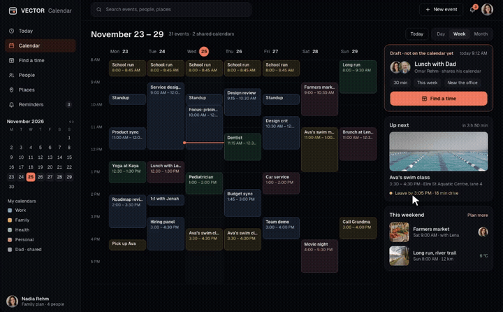

# Free Slot

**Five free gaps on Thursday, and only one fits a full hour with Dad.**



**Live demo:** [veraetogrex-portfolio.github.io/free-slot](https://veraetogrex-portfolio.github.io/free-slot/) · **Mockup:** [full-screen version](https://veraetogrex-portfolio.github.io/free-slot/mockup/free-slot.html)

A calendar Find a time screen: your day and a shared calendar side by side, a duration keeps only the free gaps it fits in, and the picked hour becomes the event. Vanilla HTML/CSS/JS, zero dependencies.

## Try it

- Press Find a time on the "Lunch with Dad" draft. Thursday opens on two lanes, yours and Dad's shared calendar: at 30 min five dashed free windows sit between the events, and every day of the week shows how many free times it has.
- Pick 1 h. The four short windows go hatched "too short" one after another, the day counts update, and the last window fills with "12:30 – 1:30 PM · Fits 1 h" and 15 min to spare. Switch durations mid-animation — the last choice wins.
- Try 15 min, 45 min or 1 h 30: only the gaps the meeting fits in stay. With several left, press Pick in the list or click a window on the lane; at 1 h 30 nothing fits and Add stays off.
- Choose a place under Lunch near both of you, then press Add 12:30 – 1:30 PM. The hour becomes "Lunch with Dad" with both avatars, the button turns into "Added to Thursday", and Back to week shows the lunch on Thursday.
- Keyboard: Tab to the Duration group, arrow keys change the duration; Enter presses Find a time, Pick and Add.
- With reduced motion on, the windows and the event change at once.

## Use it

Three files and the photos, no build step, no dependencies:

```
index.html   markup
style.css    styles
script.js    logic
assets/      the photos and portraits (generated, free to reuse with the code)
```

Download the repo and open `index.html`, or copy the files into your project. Set `data-assets` on `<section class="fs">` to the folder with your photos.

## License

MIT
